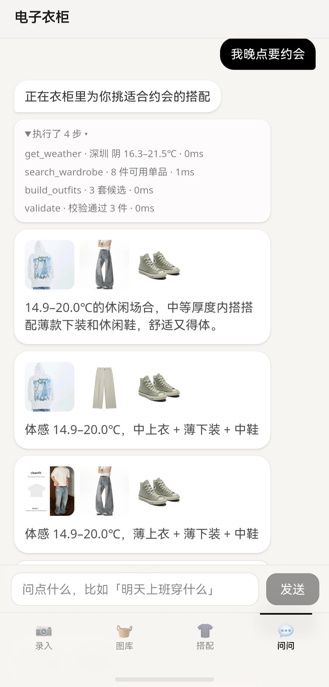
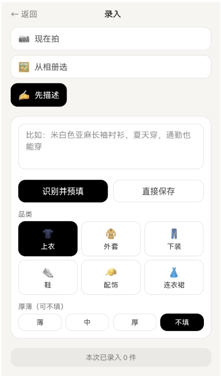
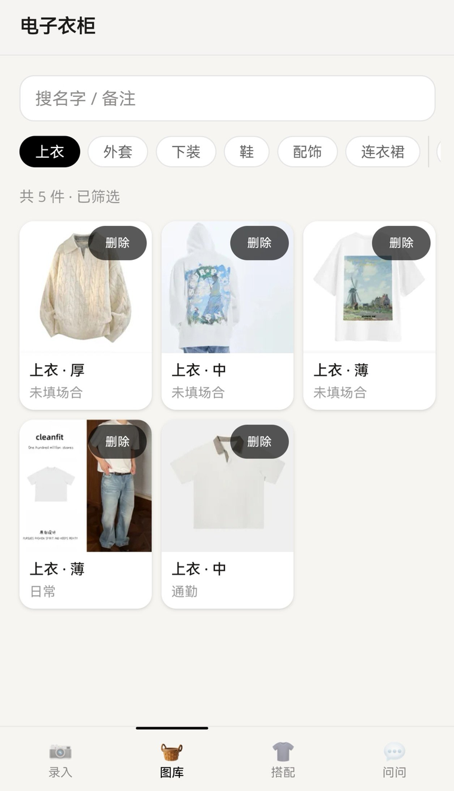
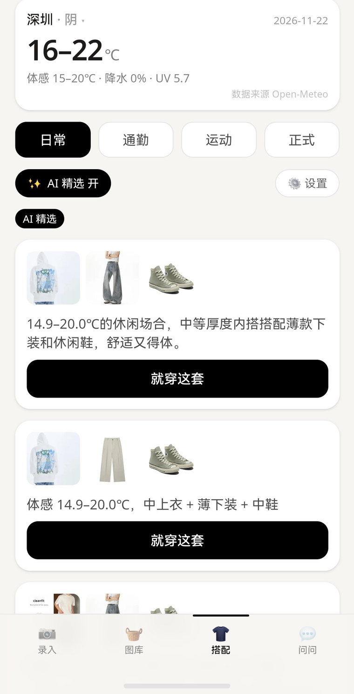

# 电子衣柜

[](https://github.com/YAO-ob/little-wardrobe/actions/workflows/ci.yml)

记录自己的衣服，按当天天气和场合给出搭配建议的单用户 Web 应用。

**TL;DR**

- Little Wardrobe — a single-user wardrobe app that turns today's weather + an occasion into three outfit recommendations.
- Stack: React + Vite + TypeScript + Tailwind · FastAPI + SQLite (WAL) + SQLAlchemy 2 + Alembic · Open-Meteo · any OpenAI-compatible LLM (BYOK).
- Highlights: closed-set candidate selection with hard validation and one repair retry, deterministic rule-based fallback, latency/token metrics API, and a no-Docker two-command local run.



## 截图

四张图都在仓库里（`docs/screenshots/`）：对话页那张放在页首当 hero，下面三张对应三个主页面。

**录入页** —— 拍完即入队，建议值虚框等你确认



**图库** —— 九宫格 + 品类/场合/信息不全筛选



**搭配页** —— 天气条 + AI 精选 + 三套规则



生成方式：按下方「本地运行」启动后，依次打开四个标签，各截一张 750px 宽的图，按 `record` / `gallery` / `outfit` / `chat` 命名放进 `docs/screenshots/`。

`chat.png` 记得**先把「执行了 N 步」展开再截**——那一条工具链（查天气 → 筛衣橱 → 组套 → 校验）是这个项目最有说服力的画面。

完整演示流程与口播要点见 [docs/DEMO.md](docs/DEMO.md)。

## 现在能做什么

- **极速录入**：选图 → 品类 → 厚薄 → 场合，三次点击一件；支持连拍队列与键盘快捷键（`1-6` / `Q W E` / `Enter`）。
- **录入自动识别**：拍照后自动建议品类与厚薄（虚框 +「建议」角标），直接按 `Enter` 采纳，按 `1-6` 覆盖；没配 key 就静默退回手动选。
- **图库与筛选**：九宫格缩略图，按品类、场合、关键字、「信息不全」筛选；点卡片打开详情，可补录颜色 / 品牌 / 材质 / 正式度 / 层次 / 季节 / 价格 / 备注。
- **单品详情补录**：颜色 / 品牌 / 材质 / 尺码 / 价格 / 洗护方式 / 购买链接；支持「从购买截图识别」品牌与价格，只填空白字段、不覆盖已填内容。
- **删除**：卡片右上角删除，按钮内二次确认，软删除可恢复（数据库层面）。
- **天气 + 3 套规则推荐**：不接模型也能出三套搭配，每套带一句中文理由。
- **AI 精选（BYOK）**：在页面填入自己的 key，让模型从规则候选里挑一套；失败自动降级并说明原因。
- **保存搭配**：「就穿这套」把当天这套写进 `outfits`，`wear_log` 视图可直接查穿着记录；搭配页底部「最近穿过」会立刻多一行。
- **对话入口「问问」**：一句话 → 单轮工具链（查天气 → 筛衣橱 → 组套 → 校验）→ 回复 + 三套搭配 + 可「换一套」。

## 技术栈与架构

| 层 | 选型 |
|---|---|
| 前端 | React + Vite + TypeScript + Tailwind，纯 SPA，分 `core` / `adapters` / `ui` 三层，`core` 不碰 `window` |
| 后端 | FastAPI + SQLite（WAL）+ SQLAlchemy 2 + Alembic，图片处理用 Pillow |
| 天气 | Open-Meteo，双模型：CMA 出温度体感、best_match 出降水概率/UV/天气码 |
| 模型层 | OpenAI 兼容协议，key 由使用者自带（BYOK），可切换 base_url 与 model |

请求链路：

```
请求 → 天气（缓存 2h）→ 规则候选（10–15 件）→ 模型只选 id
     → 四条硬校验 → 失败回灌错误重出一次 → 仍失败 → 规则结果兜底
```

三条旁路，走的都是同一套校验/降级：

- `POST /api/classify`：录入预填，只判断品类与厚薄，置信度不够就弃答。
- `POST /api/chat`：对话入口，意图解析（关键词优先，模型兜底）+ 单轮工具链。
- `POST /api/items/extract-receipt`：从购物截图提取品牌/价格/材质/颜色/尺码，不落库，只给建议。

## 本地运行

前置：Python 3.12+、Node 20+、pnpm。

```bash
# 后端
python -m venv .venv
source .venv/bin/activate            # Windows: .venv\Scripts\activate
pip install -r backend/requirements.txt
cd backend && alembic upgrade head
uvicorn app.main:app --host 127.0.0.1 --port 8000 --reload
```

```bash
# 前端（另开一个终端）
cd frontend
pnpm install
pnpm dev
```

打开 http://127.0.0.1:5173 即可；API 文档在 http://127.0.0.1:8000/docs。

## 测试

```bash
pytest backend/tests -q              # 后端 203 条
pnpm --dir frontend test             # 前端 68 条
pnpm --dir frontend typecheck
```

模型与天气相关的测试全部用 mock，不需要真实 key、不需要联网。

## 第一次运行没有数据

先启动后端，再执行：

```bash
python scripts/seed_30.py     # 生成 30 件演示单品（色块图，用于看效果）
```

脚本会通过 HTTP 调后端，因此后端必须已在 `127.0.0.1:8000` 运行。它生成的是纯色块图片，不是真实照片。

## 推荐是怎么工作的

- 规则先按体感温度分档（薄/中/厚）、场合、厚薄差与正式度打分，每类取前几件组成 10–15 件的候选池。
- 模型只在这个池子里挑 `item_id`，不允许自由生成单品。
- 后端做四条硬校验：id 必须在池内、件数 3–6、不许重复、品类覆盖（上装或裙装、下装或裙装、鞋，冷天还要外套）。
- 校验失败时把「哪些 id 非法、缺了哪类」回灌给模型重出一次；第二次仍失败就降级成规则推荐，接口始终 200。
- 一句话：**防幻觉靠候选集闭合校验，不靠 prompt 里写「不许编造」。**

**对话入口「问问」**是同一套链路的单轮版本：先跑关键词意图（天气 / 换一套 / 推荐）与场合词表，解析不出的场合才让模型兜底；然后按意图执行显式工具链（`get_weather → search_wardrobe → build_outfits → validate`），每步的摘要和耗时都返回给前端展示。

**明确不做多轮上下文**：每条消息独立解析、独立执行，不带历史。理由是「穿什么」这类问题一轮就够，多轮只会让意图漂移和成本失控；要换一套就走 `exclude_ids`，而不是靠模型记住上一轮。

## 可观测

`GET /api/metrics?days=30`（1–90 天）返回调用量、成功率、缓存命中、降级原因分布、token 消耗与延迟分位；`model_latency_ms` 只统计真实模型调用，`latency_ms` 是请求级耗时。

当前库里的真实数据（近 30 天）：

> 以下是一次开发期快照（近 30 天）。新克隆的仓库指标为 0，需要自己操作几次才会产生数据。

| 指标 | 值 |
|---|---|
| `total_calls` | 8 |
| `llm_success` | 6 |
| `fallbacks` | 1（`no_key` 1） |
| `cache_hits` | 1 |
| `model_latency_ms` | p50 1018 ms · p95 2761 ms |
| `tokens` | prompt 2020 · completion 300 |

## 配置

全部是可选的 `EW_` 前缀环境变量，示例见 `.env.example`。

| 变量 | 默认 | 说明 |
|---|---|---|
| `EW_DATA_DIR` | `./data` | 数据库与运行数据目录 |
| `EW_MEDIA_DIR` | `./media` | 原图与派生图目录 |
| `EW_DATABASE_URL` | 由 `EW_DATA_DIR` 推导 | 需要直接指定数据库连接串时用 |
| `EW_MAX_UPLOAD_BYTES` | `12582912`（12MB） | 单张原图上限，超过返回 413 |
| `EW_LLM_KEY` | 空 | 模型 key；不设也能在页面里填（BYOK），都不设则只有规则推荐 |
| `EW_LLM_BASE_URL` | `https://api.deepseek.com` | OpenAI 兼容服务的地址 |
| `EW_LLM_MODEL` | `deepseek-chat` | 模型名 |
| `EW_LLM_MAX_TOKENS` | `800` | 单次生成上限（推理模型要给够预算） |
| `EW_LLM_CACHE_TTL` | `1800` | 推荐结果缓存秒数 |
| `EW_LLM_RATE_LIMIT_PER_MIN` | `10` | 每个客户端每分钟可调模型的次数 |
| `EW_WEATHER_URL` | `https://api.open-meteo.com` | 天气上游地址；指到不可达地址可验证降级 |
| `EW_WEATHER_COOLDOWN_SECONDS` | `60` | 天气上游失败后多久不再重试（期间用快照兜底） |
| `EW_CLASSIFY_MIN_CONFIDENCE` | `0.6` | 录入预填的置信度阈值，低于它就不给建议 |

**都不设置也能跑，只是没有 AI 推荐。**

## 数据与隐私

- 原图存本地 `media/originals/`，派生图在 `media/derived/`，都不进版本库。
- 上传时按 EXIF 摆正方向，并剥离 EXIF/ICC 元数据（含 GPS），落盘文件不含拍摄地点。
- 模型 key 只存在浏览器 `localStorage`，请求时通过 `X-LLM-Key` 请求头传给自己的后端。
- 后端不落库、不写日志；日志里只有 key 的 sha256 前 8 位指纹。

## 已知限制

- 无鉴权、无登录：设计为单用户本地运行，公开部署前必须加访问控制。
- **首次运行必须能连上天气上游一次**：之后才有 DB 快照可用于离线兜底；全新库 + 上游不可用会直接 502。
- 推荐结果缓存、限流、天气冷却、识别缓存**全部是进程内的**：多 worker 或多实例时各算各的。
- 图片暂存区只在启动时清理，长跑期间未完成的图片会留在 `media/tmp/`。
- 删除是软删除，没有回收站与撤销入口；搭配没有历史页（只有「最近穿过」10 条），对话记录刷新即清。
- 软删不删文件：`python scripts/clean_media.py` 可以清掉不再被引用的图（默认 dry-run，`--apply` 才真删）。
- 上传入口分「拍照」与「相册」两个：iPhone 直出 HEIC 也支持，但 10bit/多帧的极端文件可能仍解不开（会明确报 415）。
- **识别会把图片发送给你配置的模型服务商**（录入预填、购买截图识别都是）；不配 key 就不发送。
- 衣服标签上的洗涤符号识别未实现：洗护符号只能手动点选。
- Docker 与部署脚本尚未提供（CI 已配置：`.github/workflows/ci.yml`）。

面试口径与能力边界见 [docs/INTERVIEW.md](docs/INTERVIEW.md)。

## 第三方

- 天气数据来自 [Open-Meteo](https://open-meteo.com/)，免 key、**仅限非商用**，本项目在页面与文档中署名。
- 本项目代码以 MIT 许可证发布，详见 `LICENSE`。

## 目录结构

```
电子衣柜/
├── backend/
│   ├── alembic/          # 迁移脚本（baseline → outfits → llm_metrics）
│   ├── app/routers/      # items / images / outfits / recommend / weather / metrics / cities
│   ├── app/rules.py      # 纯规则：分档、打分、组套
│   ├── app/llm*.py       # 模型客户端、候选校验、结果缓存
│   ├── app/weather.py    # 双模型取数 + 超时重试
│   └── tests/            # 接口 / 规则 / 指标测试
├── frontend/src/
│   ├── core/             # 纯逻辑：类型、API client、文案
│   ├── adapters/         # 平台差异：上传、预览、toast、key 存取
│   └── ui/               # 页面：录入 / 图库 / 搭配
├── scripts/              # seed_30.py
├── docs/screenshots/     # 四张截图（对话 / 录入 / 图库 / 搭配）
└── DECISIONS.md          # 每个技术选择的理由
```

> 本仓库的开发环境使用了 DSH 内置的 Python 与 Node 运行时（路径与系统安装不同），相关细节与踩坑记录见 [DECISIONS.md](DECISIONS.md)。
